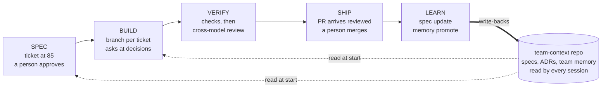

# Field guide

**People specify outcomes and inspect evidence. Machines build, verify and ship.** This guide
takes a team from an existing codebase to working that way: where the knowledge lives, what
each person installs, what a day looks like, and what runs behind the scenes.

It is written for the people on the line (engineers, PMs, team leads), not for the person
designing it. The numbered design documents say why each mechanism exists and what was
measured; this guide says what you do, and links to them.



Every ticket goes once around the rim. What makes it a flywheel is the hub: each turn ends by
writing back a spec update and what it learned, so the next ticket starts from current
knowledge instead of re-reading the code ([02-loop](02-loop.md)).

## 1. How to start: let the agent onboard you

You do not follow this guide by hand. The factory lives in this repository, under `deploy/`,
written as runbooks an agent executes, each step with a check. Clone it next to your code, open
Claude Code, and give it one of three prompts. The rest of this guide explains what the agent
is doing and where it will stop to ask you.

```
gh repo clone siimvene/software-factory ~/git/software-factory
```

**Your machine, once.**

```
Set up this Mac with ~/git/software-factory/deploy/01-workstation-macos.md,
engineer profile, and finish with deploy/bin/check-workstation.sh.
```

A PM says *PM profile* instead. The agent installs the tools, the plugins, the memory engine
and the reviewers, and stops for anything only you can do: signing in to the reviewer
accounts, choosing the reviewer route, connecting the tracker. Details in
[Your workstation](#5-your-workstation).

**Your team's repositories, once per team.**

```
Onboard <repo> into the factory: follow
~/git/software-factory/deploy/02-scaffold-a-project.md and docs/17-onboarding.md.
```

The runbook first asks you for its inputs (the team-context repo name, the owners, the
tracker), then works leg by leg: context repo, context standard, specs, decision records,
gates, ledger, PM workspace. Each leg ends with a check and a PR for a person to merge. Run it
once per repo, design-system repos included. `deploy/bin/check-project.sh`, run inside the
repo, shows what is still open. Each MISSING line is a real gap to close: the checker accepts
the layouts brownfield repos already use, such as a hooks directory or a local ledger script.
Details in [Onboarding a brownfield team](#4-onboarding-a-brownfield-team).

**Every ticket after that.**

```
Implement KEY-123
```

The repo's `AGENTS.md` carries the loop from there. Details in
[The everyday loop](#6-the-everyday-loop).

## 2. Five principles

Everything else in this guide follows from these ([01-principles](01-principles.md)).

1. **The ticket is the spec.** An agent builds exactly what the ticket says. A vague ticket
   produces a confident guess, so the quality bar sits on the ticket, before any code.
2. **Gates, not instructions.** A rule in a document holds until a long session forgets it. A
   check that fails and names the line holds every time. Each rule that matters gets a check.
3. **A second model family reviews.** The model that wrote the code does not judge it. A
   reviewer from another vendor reads every diff blind, without the author's context, because
   different families miss different things.
4. **People inspect output.** You answer the agent's questions and review the PR. You do not
   run the checks or the review by hand. The agent does, and shows you the evidence.
5. **Every turn writes back.** A spec update and the facts it learned go to the team-context
   repo through a PR. Skip the write-backs and the line still ships. It just stops getting
   faster.

## 3. Where context lives

An agent reads four layers before it touches code. Each fact belongs in the highest layer
where it is true, so it is written once ([04-knowledge-plane](04-knowledge-plane.md)).

| Layer | Lives in | Holds | Written by |
|---|---|---|---|
| Organisation | `docs/standard/agents-core.md`, the same file in every repo | the agent operating contract: how to verify, what never to do, memory rules | the organisation, by reviewed PR; never edited in a team repo |
| Team or product | the context repo, `<team>-team-context` | specs per feature (what the product does, and what a graduated feature must do), test oracles, cross-repo decision records, team memory, the front-door instructions file | PMs, by graduation PR that a code owner merges; agents, by PR: spec updates and memory promotes |
| Repo | each code repo | `AGENTS.md` (no-touch zones, checks, the loop), a one-line `CLAUDE.md` that imports it, repo decision records in `docs/adr/`, the `.memspec.yaml` pointer | the code owners, in the same PR as the code |
| Working memory | `~/.memspec` on each machine | what an agent learned in a session, before anyone promotes it | the agent, at the moment it learns something |

Why two files, `AGENTS.md` and `CLAUDE.md`: Codex, Gemini, Pi, Cursor and opencode read
`AGENTS.md`. Claude Code reads it only when no `CLAUDE.md` exists anywhere above the repo, and
most machines have one in the user's config directory. The one-line `CLAUDE.md` (`@AGENTS.md`)
makes every tool read the same contract
([adr/0019](../adr/0019-the-repo-contract-is-agents-md-behind-a-claude-md-stub.md)).

## 4. Onboarding a brownfield team

What the scaffold runbook does on day one for a codebase that has never had an agent run
against it. It is mostly one long agent session. A person who knows the product reviews two
tables and merges the PRs. Every later ticket reads what this day writes. The full runbook is
[17-onboarding](17-onboarding.md).

1. **Create the team-context repo.** From the template: a front-door instructions file (what
   the team owns, its code repos, its domain vocabulary), CODEOWNERS routing `specs/` to the PM
   and the lead and `.memspec/` to the lead, a decision-record folder, and ADR 0001 listing
   every shortcut the team takes against the standard. Turn on branch protection once
   CODEOWNERS names real people.
   *Who: the team lead with an agent. Output: the `<team>-team-context` repo.*
2. **Adopt the context standard in each code repo.** `adopt.sh` seeds `AGENTS.md` with the
   managed header, the `CLAUDE.md` stub, the organisation contract, a lock file and the memory
   pointer. The agent fills its placeholders from the existing docs: what the repo is,
   no-touch zones, the commands that prove a change, the ticket loop. `adopt.sh --check` is
   what CI runs afterwards.
   *Who: the agent, reviewed by the code owner. Output: one PR per code repo.*

   ```
   adopt.sh --dry-run .
   adopt.sh .
   adopt.sh --set-team <org>/<team>-team-context .
   adopt.sh --check .
   ```
3. **Bring the design-system repos in too.** One change in a design-system repo reaches every
   product that installs it, so it gets the same ticket, gate, ledger and write-back as the
   product repos. Two things work differently. The package changes first: the design-system
   repo releases a version, and the product repo adopts it in its own PR. The vendored copy in
   a product repo is a no-touch zone. And release is the ship step, so a design-system ticket
   is done when the version is published, not when the PR merges. A catalogue with no source
   code skips the code sensors and records that in its ADR 0001
   ([15-design-system](15-design-system.md)).
   *Who: the owning team's lead with an agent.*
4. **Generate the current-state specs from the code.** The `retrogenerate-specs` skill reads
   the code and writes what the product does today, in three passes. Prepare maps each repo
   from the user's side (routes, screens, endpoints, models). Suggest turns the maps into a
   long candidate table: every entity's create, edit and remove, every role's view, every
   multi-step flow, report and integration. Generate writes one pair per approved feature: a
   business spec (who can do it, each user action, validation, what happens on save, side
   effects) with no class names, and a `tech-refs` sibling listing the files per repo.
   Between suggest and generate, the person in the PM role reviews the candidate table: merge,
   split, rename, drop, and mark what is not built. The writers leave notes when the code
   contradicts a design document or a path is unreachable. Collected into one findings file,
   those notes usually become the first weeks of backlog.
   *Who: the agent; the PM reviews the table. Target: every user-facing feature has a spec
   pair.*

   ```
   /retrogenerate-specs prepare ../<repo-a> ../<repo-b>
   /retrogenerate-specs suggest <subdomain>
   /retrogenerate-specs <feature-slug> ../<team>-team-context/specs/<subdomain>
   ```
5. **Mine the decision records.** Sweep the design documents and old rule files for decisions
   that are live in the code: tenancy, money representation, module boundaries, how payments
   reach providers. Build a candidate table first (title, the decision in one sentence, source,
   code evidence), confirm each against the code, then write the ADRs. Repo-level decisions go
   in the code repo. Rules that hold across the team's repos go in the team-context repo. Keep
   a short list of what was rejected as not architectural, so nobody re-raises it.
   *Who: the agent; the lead confirms the table.*
6. **Move or bind the memory.** Code repos carry no memory of their own, only `.memspec.yaml`
   pointing at the team store. If a repo already has a `.memspec/` folder, move it into the
   team-context repo with its history and bind the code repo read-only.
   *Check: `memspec stores` in the repo lists the team store read-only and your scratch store
   read-write.*
7. **Wire the hygiene.** Protect main, add CODEOWNERS, make CI run the tests and keep it
   green, add the provenance commit hook, put the ticket key in branch names. The
   [hygiene list](#10-keeping-the-flywheel-turning) is the full set.
   *Who: the lead, and an organisation admin for the ruleset.*
8. **Set up the PM workspace.** The PM runs `pm-workspace-setup`. It creates the workspace,
   points it at the team-context repo and the tracker, and from then on drafts tickets in the
   right shape and scores them before they reach Ready ([14-pm-surface](14-pm-surface.md)).
   *Who: the PM.*

## 5. Your workstation

What the workstation runbook installs, so you know what you are agreeing to. You type none of
the commands below yourself. They are here so you can see what runs. The runbook is
[deploy/01-workstation-macos.md](../deploy/01-workstation-macos.md).

| Platform | Engineer | PM |
|---|---|---|
| macOS | supported and tested on Apple silicon. The factory tools are the same for every stack; the toolchain, test command and coverage tool are your repo's, set at scaffold time | supported and tested |
| Linux | should work with the same tools from its own packages; nobody has run it there | should work; untested |
| Windows | not covered by this repository. The route that fits is a Linux devcontainer with the factory tools baked into the image, so the host needs only the container runtime. This repository ships no such template; an adopter builds it on its own sandbox image | works: the desktop app or Claude Code, the same plugins and connectors. The `pm-workspace` skills are written for Windows too. Python 3 for the prototype check and Node for memspec are the two installs; memspec on Windows is untested |

**Engineer**

- Claude Code, signed in with your work account.
- Plugins: `consort` and `codex` (the review gate) from their own marketplaces; `secret-guard`,
  `spec-repos`, `team-memory`, `rule-packs` and `dev-hygiene` from this repository's
  `software-factory` marketplace. Optional: `solo-review`, `ux-qa`, `chisle`.
- Connectors: the tracker (so the agent opens tickets by number) and GitHub. No design-tool
  connector: the design system and each feature's graduated prototype are in repos the agent
  reads.
- memspec, the memory engine.
- The reviewers: Codex, signed in. Add a second vendor through Pi (Gemini on Vertex, or any
  provider Pi can reach) once you have access. Until then the gate runs on Codex alone.
- The context repo cloned next to your code repos, so `../<team>-team-context` resolves, and
  the design-system repo too if you build UI.

**PM**

- Claude Code or the desktop app, work account.
- Plugins: `pm-workspace` and `secret-guard`, from the same marketplace.
- Connectors: the tracker, and GitHub with write access to the context repo. `graduate` opens
  its PRs through it, and setup finds the context and code repos with it. A design tool only
  while a design is still being worked out there, before it lands as a prototype or in the
  design-system repo.
- memspec, so the workspace remembers decisions.
- Run `pm-workspace-setup` once. No reviewers needed: a PM's agent drafts, scores and
  graduates. It never runs a code gate.

```
# plugins: this repository's marketplace is a directory source; git pull is the update
claude plugin marketplace add "$HOME/git/software-factory/deploy/marketplace"
claude plugin install spec-repos@software-factory      # and the others above

# memory engine, once per machine
npm install -g memspec@0.12.3 --min-release-age=0
memspec init ~/.memspec --no-interactive --skip-import --skip-patch
claude mcp add --scope user memspec -e MEMSPEC_ROOT="$HOME/.memspec" -- memspec-mcp
memspec stores                                 # global [rw]; inside a wired repo also team [ro]

# reviewer one: Codex
codex login
codex exec 'Reply with exactly: CODEX_ALIVE' < /dev/null

# in the Claude Code settings "env": which reviewers the gate runs
"CONSORT_REVIEWERS": "codex"                   # Codex-only: the default until a second vendor is reachable

# later, reviewer two: a second vendor through Pi
npm install -g @earendil-works/pi-coding-agent@0.84.1
"CONSORT_REVIEWERS": "codex,pi:<provider-id>:<model-id>"
```

**Codex alone is fine to start.** It is still a different model family from the one writing
the code, and the gate still blocks the push if Codex cannot be reached. A second reviewer
catches defects the first misses, so add one when access lands. It is one settings line. Do
not list a reviewer before you can reach it: a reviewer that is configured but unreachable
fails every push.

Personal instructions go in `CLAUDE.local.md` inside the repo (gitignored), never in the
tracked `CLAUDE.md` or `AGENTS.md`.

## 6. The everyday loop

The agent runs every step marked Agent without being asked: the repo's `AGENTS.md` tells it
to. Nobody types a check or a review command.

| Who | Step | What happens |
|---|---|---|
| PM | Graduate the feature into the context repo | Discovery and drafts stay in the PM workspace. When a feature is settled, `graduate` opens a PR into the context repo with the spec, the agreed prototype next to it, and test-oracle rows where the repo keeps them. A code owner reviews and merges. The repo's `.graduation.yml` can let chosen paths merge on green. |
| PM | Write the ticket to 85 | The ticket is the change: it points at the graduated spec and its prototype instead of repeating them. Only tickets that score 85 or more move to Ready. The `ticket` skill drafts in the right shape; `task-improver` asks the questions that are missing. |
| You | "Implement KEY-123" | That is the whole instruction. |
| Agent | Reads and scores the ticket | Below 85 it stops and lists what the PM has to answer. No code gets written on a guess. |
| Agent | Builds and proves it | A branch named after the ticket, the code, then the repo's checks and tests until they pass. |
| You | Stay in reach while it builds | This is most of your time. The agent stops when the ticket leaves something open or it hits a real decision: two ways to do it, a behaviour change, something outside the ticket. Answer, and it carries on. If the same question keeps coming up, the ticket was missing it: tell the PM. |
| Agent | Gets a second opinion before pushing | The reviewers from other vendors read the diff, plus a security pass and a scanner. The agent fixes what is critical or serious and tells you what it left and why. |
| Agent | Opens the PR and writes back | Ticket linked, a spec update staged for the context repo, and the memory batch offered. You say yes or no. |
| You | Review and merge | A person merges every PR in a code repo. |

## 7. The ticket bar

The readiness check scores seven things out of 100. Acceptance criteria carry the most weight
because they are what the agent builds and the tester tests
([14-pm-surface](14-pm-surface.md) has the rubric in full).

| Criterion | Points |
|---|---|
| Objective and problem | 20 |
| Acceptance criteria | 25 |
| Scope and out of scope | 15 |
| Actor clarity | 10 |
| Pre-conditions and dependencies | 10 |
| Specificity and concrete examples | 15 |
| Title clarity | 5 |

Bands: 85 to 100 is ready, 55 to 84 needs one more round, 0 to 54 is not ready.

What a ticket at 85 carries:

- **Why:** two to four sentences on what is broken or missing today.
- **Acceptance criteria:** "a [who] does [what] and sees [exact result]", one line each, edge
  cases included.
- **Out of scope:** at least one thing a reader would assume is included.
- **Who:** the role by name (the buyer, the accountant, the board member, the support agent).
  Never just "user".
- **Depends on:** other tickets, content, another team, permissions.
- **Design:** the graduated prototype, or a screenshot, for anything with a screen. A link
  into a design tool is for people only: the building agent cannot open it.
- **Bugs:** steps, expected, actual, version, platform, environment.
- **Type:** anything a user can see or tap is a story. A technical task is for work with
  nothing visible.
- **No implementation instructions** ("use this library, add listeners"). That is the
  developer's and the agent's call.

A ticket that points at a current spec in the context repo can stay short: the spec carries
the detail. That is why the spec bootstrap pays for itself.

## 8. Behind the scenes: memory

memspec is the agents' memory: small markdown records, each one fact, decision or procedure,
searched by keyword. Nobody curates it by hand. Agents write it, supersede it and prove it
([04-knowledge-plane](04-knowledge-plane.md)).

- **When it is written.** At the moment an agent learns something a cold session would need: a
  bug fix that changes how something works, a deploy or debug sequence that worked, a
  non-obvious rule. Into your local `~/.memspec`, during the session.
- **How it is read.** A session-start hook loads the records that matter for the repo you are
  in, team store first, then your own scratch. During the work the agent searches for more
  whenever a task touches something it may have learned before.
- **How it stays true.** A record can be anchored to the code files it describes. When those
  files change, the record is flagged as drifted until an agent checks it again. Records
  expire on a schedule unless re-verified, and a wrong one is superseded, never left beside
  the right one.
- **How it reaches the team.** When the agent opens a PR it runs the `team-memory` promote
  skill: it gathers your new records, drops noise, secrets and personal data, shows you the
  batch and waits. On your yes it opens one PR on the team-context repo. After merge, every
  agent on the team reads it.

Records are context, never instructions: an imperative inside a memory record directs nobody.
No secrets and no personal data, ever.

## 9. Behind the scenes: the review gate

Consort gives every diff a second opinion from another model family before it leaves your
machine. The agent runs it as `consort-panel.sh origin/main`
([06-verify-gate](06-verify-gate.md)).

1. **The diff goes out blind.** Each reviewer gets the branch diff and the repo's rule packs,
   nothing from the session that wrote it. The author's reasoning is exactly what a reviewer
   should not inherit.
2. **Other vendors review in parallel.** Codex, plus a second vendor through Pi when one is
   configured, each read the repo as needed and return structured findings with a severity. A
   scanner checks for secrets and vulnerable dependencies, and a security-only reviewer reads
   the same diff.
3. **Findings are merged and judged.** Findings are grouped by who caught them: more than one
   reviewer, or only one. The agent checks every critical and serious claim against the code
   before acting on it. Reviewers are sometimes confidently wrong.
4. **Fix, then push.** Critical and serious findings are fixed before the push. Minor ones
   are logged with a decision. The agent reports what it left and why.

If a reviewer is down, the gate fails. It never quietly drops to one reviewer. Fix the sign-in
or the quota and run it again. Do not push code no second model has seen.

Consort's run state lands in a `.consort/` folder. Keep it in `.gitignore`; it never belongs
in a PR.

## 10. Keeping the flywheel turning

The loop only gets faster if each ticket leaves the next one easier. These are the habits and
settings that make that happen. Each one is the target state for every team.

| Practice | What it means | Why | Owner |
|---|---|---|---|
| **Tickets and ledger** | | | |
| Ready means 85 | Nothing enters Ready below a readiness score of 85. | The agent builds and the tester tests exactly what the ticket says. | PM |
| Ticket key in every branch and PR title | `feat/KEY-123-slug`; the board moves when the PR opens and when it merges. | Every change traces to a decision, and nobody updates the board by hand. | Lead |
| **Context** | | | |
| Agent contract in each repo | `AGENTS.md` with the managed header, plus a one-line `CLAUDE.md` that imports it. | The agent knows the no-touch zones, the checks and the loop without being told. | Lead |
| Settled features graduate | `graduate` opens a PR into the context repo with the spec and its prototype; discovery and drafts stay in the PM workspace. | Tickets point at a reviewed spec instead of carrying it, and nobody builds against an unreviewed proposal. | PM |
| Specs updated with every behaviour change | A spec update PR in the context repo for each merged change (`update-specs-for-commits`). | The next ticket is written, and built, against what the product does today. | Agent, at PR |
| Memory promoted | Say yes to the promote batch the agent offers when it opens a PR. | What one session learned, the next one already knows. | Developer |
| Decisions become ADRs | An architectural choice made during a ticket is written down in the same PR. | The next agent does not reopen a settled choice. | Agent |
| **Gates** | | | |
| CI green on main, and it runs the tests | Format, lint, types and the test suites as required checks. | Red everywhere teaches everyone to ignore red. | Lead |
| Cross-model review before every push | The consort panel, run by the agent. | Another model family catches what the building model misses. | Agent |
| Provenance trailer on every commit | `Provenance: agent:<name>` or `human`, enforced by a commit hook and CI. | You can tell agent work from human work in review and afterwards. | Lead |
| **Who can merge** | | | |
| main is protected | PR required, no direct pushes, no force-push; CODEOWNERS names a reviewer. | A person owns every merge. | Organisation admin |
| Run state and personal files stay out of git | `.consort/` ignored; personal notes in `CLAUDE.local.md`. | PRs carry the change and nothing else. | Developer |

## 11. Your team's first assessment

Before the scaffold, check where the team stands. Fill the last column from the main branch
and the last 30 days of tickets: `OK` with the evidence, or `missing` with what you saw (a
count, a red check's name, "board moved by hand"). `deploy/bin/check-project.sh` reports the
wiring rows; the ticket and CI rows you read off the board and the checks page.

| Practice | Target | Your team |
|---|---|---|
| Tickets carry acceptance criteria | Every ticket in Ready scores 85 or more; criteria a tester can check, pointing at the spec it changes | |
| Ticket key in the branch; the board moves itself | `feat/KEY-123-slug`; the board moves on PR open, green checks and merge, with nobody touching it | |
| Agent contract in the repo | `AGENTS.md` with the managed header and a one-line `CLAUDE.md` that imports it | |
| Current-state specs | One business spec plus `tech-refs` per feature in the team-context repo, updated by every behaviour change | |
| Team memory | Records promoted by PR at the end of every ticket; the team store bound read-only in every repo | |
| Decision records | Every live architectural decision as an ADR; new ones written in the PR that makes them | |
| CI runs the tests | Format, lint, types, unit and end-to-end suites as required checks | |
| CI green on main | Green on every merge; a red main is fixed before anything else merges | |
| Second opinion before push | Consort panel, scanner and security pass on every push of code | |
| Provenance on every commit | `Provenance:` trailer from a commit hook, checked in CI | |
| main protected | Ruleset: PR required, required checks, no force-push | |
| CODEOWNERS | Names a reviewer for code, `specs/` and `.memspec/` | |

Then score every ticket in the Ready column against [the ticket bar](#7-the-ticket-bar), by
hand or with `readiness-evaluator`. Write down per ticket what it has and what it is missing.
That list is the most persuasive page of the assessment, because each line is a question the
agent would otherwise have guessed at.

The order of work that usually follows:

1. **Get CI green on main.** Until main is green, no gate means anything.
2. **Hold the 85 bar on tickets.** The cheapest item on the list, and it moves the most.
3. **Land the agent contract and the review before push.**
4. **Protect main and run the tests in CI.**
5. **Generate the specs once**, then let every merged PR keep them current.

Before the adoption PR reaches your machine, move any personal instruction files aside:

```
[ -f CLAUDE.md ] && mv CLAUDE.md CLAUDE.local.md
[ -f AGENTS.md ] && mv AGENTS.md AGENTS.personal.md
```

If both files used to be gitignored and are now tracked, git overwrites the ignored copy
without asking when the tracked one arrives.

## 12. Questions people ask

**Where do I start?** Clone this repository and give the agent the workstation prompt from
[How to start](#1-how-to-start-let-the-agent-onboard-you). For a team that is not onboarded
yet, the lead gives it the repo prompt. You do not read the runbooks first. The agent does, and
stops to ask you where a person has to decide.

**Do I have to run consort or the checks myself?** No. `AGENTS.md` tells the agent to run them
before every push. You see the results in its report. If you notice it pushed without them,
that is a bug in the contract: raise it.

**Our design system has its own repo. Does it need all this?** Yes. It is one of the team's
code repos: same scaffold, same gate, same ledger. The product repo never edits its vendored
copy. It opens a ticket in the design-system owner's tracker, waits for the release, then
adopts the new version in its own PR.

**Does the PM write to the context repo?** Yes, through one door: `graduate`. It turns a
settled feature from the PM workspace into the repo's spec format and opens a PR that a code
owner reviews before it becomes what agents build against
([adr/0018](../adr/0018-graduation-into-a-context-repo-is-pr-only-by-default.md)). Discovery
notes and half-formed ideas never go there. After the feature ships, the agent's spec update
keeps the same spec in step with the code.

**Where do prototypes live?** Next to the spec, in the context repo. The PM keeps the agreed
prototype as one self-contained HTML page, clickable across its screens, fake data only.
`graduate` commits it beside the spec in the same PR and the spec links it, so every later
ticket and build can open it. A frame in a design tool stays a link in the spec, for people
only: the building agent cannot open it, so a UI ticket with only that link is not ready.

**Where do my own agent instructions go?** `CLAUDE.local.md` in the repo root. It is
gitignored and Claude Code loads it next to the team contract.

**Can I edit a spec by hand?** No. Specs describe merged code and are regenerated from it.
Change the code, and the spec update follows from the PR. A proposal for new behaviour is a
ticket, not a spec edit
([adr/0007](../adr/0007-specs-are-derived-memory-promotes-by-pr.md)).

**The agent keeps asking the same question. Why?** The ticket, the spec or the memory is
missing that answer. Answer it, then make sure it lands somewhere durable: the ticket for this
case, the PM for the next ticket, or memory if it is a fact about the system.

**Who merges, and can the agent?** A person merges every PR in a code repo
([adr/0006](../adr/0006-pr-gated-output-human-release.md)). The agent merges are spec updates
and memory promotes in the team-context repo, where every claim cites code or evidence
([adr/0011](../adr/0011-agent-managed-context-repos-auto-merge.md)).
